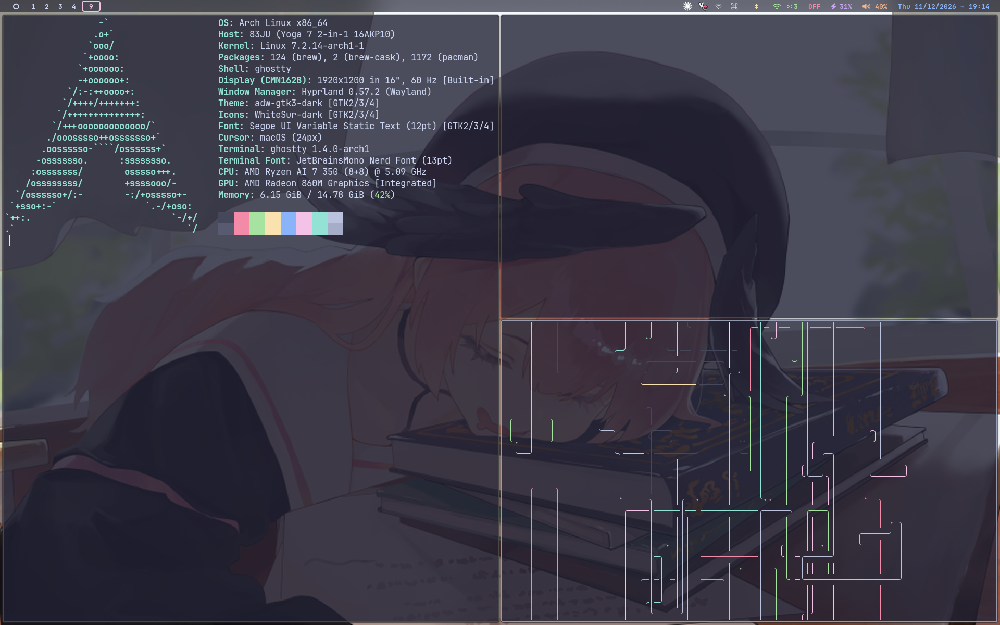
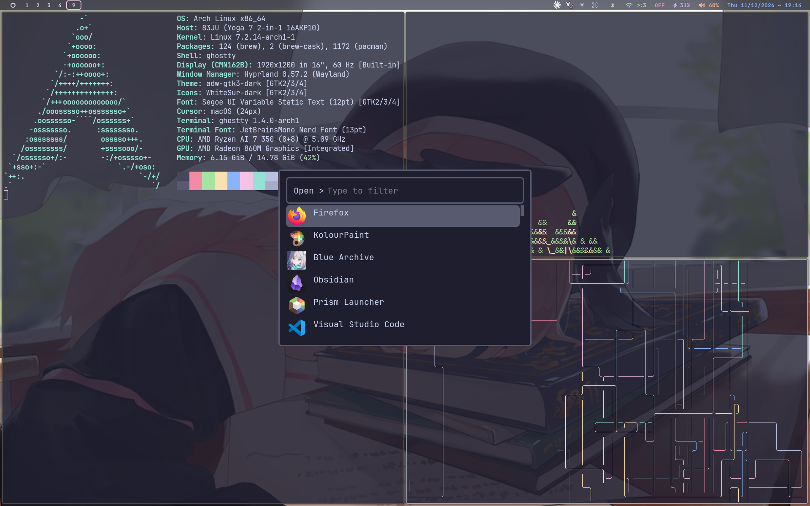

# secretnarwhal's Arch + Hyprland dotfiles

Everything needed to rebuild this Arch Linux + Hyprland desktop exactly as it is: every config file, the full package list, cursors, wallpapers, system tweaks, and a one-shot installer.




> Based on [ViegPhunt/Dotfiles](https://github.com/ViegPhunt/Dotfiles) + [ViegPhunt/Arch-Hyprland](https://github.com/ViegPhunt/Arch-Hyprland) (MIT). Upstream history is kept; my changes are committed on top. The biggest one is the migration of the Hyprland config to **Lua**.

---

## Quick install

On a fresh Arch install (`base base-devel git`), as your normal user:

```bash
git clone https://github.com/secretnarwhal/dotfiles.git ~/dotfiles
cd ~/dotfiles
./install.sh
```

The repo **must** be cloned to `~/dotfiles`. `install.sh` does the following:

1. Enables `[multilib]` and runs a full system update
2. Bootstraps `yay`
3. Installs every explicitly installed package from [`packages/pacman.txt`](packages/pacman.txt) (151) and [`packages/aur.txt`](packages/aur.txt) (19)
4. Clones TPM for tmux
5. Moves conflicting files to `~/.dotfiles-backup-<date>/`, then `stow`s everything into `$HOME`
6. Copies the wallpapers to `~/Pictures/Wallpapers` and builds the hyprlock background
7. Sets the system cursor fallback, GTK theme, fonts and Nemo terminal
8. Sets `zsh` as the login shell
9. Enables services: `bluetooth`, `NetworkManager`, `power-profiles-daemon`, `cronie`, `systemd-timesyncd`, **`ly@tty2`**, and the user service `hypridle`
10. Optionally applies the GRUB config (Vimix theme) and fingerprint PAM (each step asks first)
11. Installs the waybar VPN-module scripts into `~/.local/bin`

Then reboot, log in through **ly** on tty2, and choose Hyprland. On first login press <kbd>Super</kbd>+<kbd>W</kbd> and pick `147314954_p0` to get the same wallpaper.

### Manual steps after install
| What | How |
|---|---|
| Fingerprint for hyprlock/sudo | `fprintd-enroll` |
| tmux theme (catppuccin-tmux) | inside tmux: <kbd>Ctrl</kbd>+<kbd>b</kbd> then <kbd>I</kbd> |
| VPN menu in waybar | edit `~/.local/bin/vpn-toggle.sh` with your `swanctl` connection names and add the sudoers rule shown in its header |
| Headphone L/R swap | the sink target in `.config/pipewire/pipewire.conf.d/headphone-swap.conf` is hardware-specific; see [AUDIO_SWAP_DOCS.md](AUDIO_SWAP_DOCS.md) |
| Neovim plugins | open `nvim` once; lazy.nvim installs the versions pinned in `lazy-lock.json` |

---

## The stack

| Role | Program | Config |
|---|---|---|
| Compositor / WM | **Hyprland 0.57** (Lua config, `dwindle` layout) | `.config/hypr/hyprland.lua` + `conf/*.lua` |
| Display manager | **ly** on tty2 (default config, no theme) | `ly@tty2.service` |
| Terminal | **Ghostty**, JetBrainsMono Nerd Font 13, Catppuccin Mocha, **80% opacity** (blurred by Hyprland) | `.config/ghostty/config` |
| Shell | **zsh** + zinit (syntax-highlighting, completions, autosuggestions, fzf-tab) | `.zshrc` |
| Prompt | **oh-my-posh** (`viet.omp.json`); bash uses starship | `.config/ohmyposh/`, `.config/starship.toml` |
| Shell candy | `pokemon-colorscripts` on every new shell, `eza`, `bat`, `zoxide`, `fzf` (Catppuccin colors) | `.zshrc` |
| Bar | **Waybar** (top; 60% alpha background, blurred) | `.config/waybar/` |
| Launcher | **Rofi** (apps, emoji, clipboard, wallpaper picker, VPN menu) | `.config/rofi/config.rasi` |
| Notifications | **SwayNC** (blurred) | `.config/swaync/` |
| Logout menu | **wlogout** (blurred) | `.config/wlogout/` |
| Lock / idle | **hyprlock** (blurred wallpaper, big clock, fingerprint) + **hypridle** | `.config/hypr/hyprlock.conf`, `hypridle.conf` |
| Wallpaper | **awww** daemon (transition `any`, 2 s) | `.config/viegphunt/wallpaper_*.sh` |
| Screenshots | **hyprshot** region → `~/Pictures/Screenshots` | keybind |
| Clipboard | `cliphist` + `wl-paste` watchers | autostart |
| Editor | **Neovim** (lazy.nvim, Catppuccin, treesitter, LSP, neo-tree, telescope, snacks, wrap-aware folding) | `.config/nvim/` |
| Multiplexer | **tmux** + TPM + catppuccin-tmux | `.tmux.conf` |
| File manager | **Nemo** (terminal → ghostty) | gsettings |
| Browser / Discord / Music | **Brave**, **Vesktop**, **YouTube Music** | `conf/programs.lua` |
| Audio viz | **cava** + GLSL shaders | `.config/cava/` |
| Input method | **fcitx5** (us layout; bamboo installed) | `.config/fcitx5/` |
| Polkit | `hyprpolkitagent` | autostart |
| Audio | PipeWire + WirePlumber, plus a virtual "Headphones Swapped" sink | `.config/pipewire/` |
| Bootloader | **GRUB**, Vimix theme, os-prober on | `system/etc/default/grub` |

### Look and feel
| Setting | Value |
|---|---|
| Color scheme | **Catppuccin Mocha** everywhere (`.config/colors/colors.css` / `.rasi`) |
| Gaps | inner `2`, outer `5` |
| Borders | `2px`; active `rgba(cdd6f4aa)`, inactive `rgba(595959aa)` |
| Rounding | `2` (power 2) |
| Window opacity | active/inactive `1.0` (only Ghostty itself is transparent, at `0.8`) |
| Blur | on: size `6`, passes `3`, `ignore_opacity`, new optimizations; layer blur on waybar, wlogout, swaync |
| Shadow | range `4`, render power `3`, `rgba(1a1a1aee)` |
| Animations | bezier `overshot (0.13,0.99,0.29,1.05)` + `ease`; windows `gnomed`, windowsOut `slide bottom`, workspaces `slide` |
| GTK theme | `adw-gtk3-dark`, prefer-dark |
| Icons | `WhiteSur-dark` |
| Cursor | **Plana** (custom Xcursor, shipped in `.local/share/icons/Plana`, set as `~/.icons/default`); gsettings and the system fallback use `macOS` (apple_cursor); GTK2 uses Catppuccin-Mocha-Mauve |
| UI font | Segoe UI Variable Static Text 12 (`ttf-segoe-ui-variable`) |
| Mono font | JetBrainsMono Nerd Font (13 in the terminal, 12 for GTK mono) |
| Qt | `qt5ct`/`qt6ct` platform theme, `QT_STYLE_OVERRIDE=kvantum` |
| Default apps | Brave for http/https/html, Loupe for images, Vesktop for `discord://` (`.config/mimeapps.list`) |

### Input
- Layout `us`, **Caps Lock disabled** (`caps:none`)
- Mouse `accel_profile = flat`, sensitivity 0, focus follows mouse
- Touchpad: natural scroll, scroll factor 0.5, **3-finger horizontal swipe = switch workspace**

---

## Keybindings

`Super` is the main modifier. Press <kbd>Super</kbd>+<kbd>H</kbd> for an on-screen cheat sheet.

| Keys | Action |
|---|---|
| <kbd>Super</kbd>+<kbd>Space</kbd> | Terminal (Ghostty) |
| <kbd>Alt</kbd>+<kbd>Space</kbd> | App launcher (rofi) |
| <kbd>Super</kbd>+<kbd>E</kbd> | File manager (Nemo) |
| <kbd>Super</kbd>+<kbd>B</kbd> | Browser (Brave) |
| <kbd>Super</kbd>+<kbd>D</kbd> | Discord (Vesktop) |
| <kbd>Super</kbd>+<kbd>M</kbd> | YouTube Music |
| <kbd>Super</kbd>+<kbd>Q</kbd> | Close window |
| <kbd>Super</kbd>+<kbd>Shift</kbd>+<kbd>Q</kbd> | Kill the active window's process |
| <kbd>Super</kbd>+<kbd>Shift</kbd>+<kbd>Ctrl</kbd>+<kbd>Esc</kbd> | Exit Hyprland |
| <kbd>Super</kbd>+<kbd>F</kbd> | Toggle floating |
| <kbd>Super</kbd>+<kbd>P</kbd> | Pseudo-tile (dwindle) |
| <kbd>Super</kbd>+<kbd>J</kbd> | Toggle split direction (dwindle) |
| <kbd>Super</kbd>+<kbd>L</kbd> | Lock screen (hyprlock) |
| <kbd>Super</kbd>+<kbd>.</kbd> | Emoji picker |
| <kbd>Super</kbd>+<kbd>V</kbd> | Clipboard history |
| <kbd>Super</kbd>+<kbd>W</kbd> | Pick wallpaper |
| <kbd>Super</kbd>+<kbd>Shift</kbd>+<kbd>W</kbd> | Random wallpaper |
| <kbd>Super</kbd>+<kbd>Shift</kbd>+<kbd>S</kbd> | Region screenshot → `~/Pictures/Screenshots` |
| <kbd>Super</kbd>+<kbd>←↑→↓</kbd> | Move focus |
| <kbd>Super</kbd>+<kbd>1</kbd>…<kbd>0</kbd> | Go to workspace 1–10 |
| <kbd>Super</kbd>+<kbd>Shift</kbd>+<kbd>1</kbd>…<kbd>0</kbd> | Move window to workspace 1–10 (and follow) |
| <kbd>Super</kbd>+<kbd>Shift</kbd>+<kbd>Alt</kbd>+<kbd>H</kbd> | Move window to hidden special workspace `ghost` |
| <kbd>Super</kbd>+<kbd>Shift</kbd>+<kbd>Ctrl</kbd>+<kbd>H</kbd> | Show/hide the `ghost` workspace |
| <kbd>Super</kbd>+scroll | Cycle existing workspaces |
| <kbd>Super</kbd>+LMB / RMB drag | Move / resize window |
| <kbd>Super</kbd>+<kbd>F10</kbd> | Toggle headphone L/R channel swap |
| Volume keys | ±5% (max **150%**), mute, mic mute |
| Brightness keys | ±10% |
| Media keys, and **Caps Lock** (`code:66`) | play/pause, next, prev (playerctl) |

## Window rules
- Ignore maximize requests from all apps
- Fix XWayland drag ghosts (no-focus on empty class/title floating XWayland windows)
- No blur on floating XWayland windows
- Blue Archive (`steam_app_3557620`): hide the 1×1 "Windows 98" artifact window, force the game window to tile, and suppress its maximize/fullscreen requests
- Workspaces 1–10 are bound to `eDP-1` (the laptop panel); monitors use `preferred, auto, 1`

## Autostart
waybar, swaync, awww-daemon, nm-applet, fcitx5, the cliphist watchers (text and image), `gtkthemes.sh`, hyprpolkitagent, hypridle, the dbus activation env, and a Ghostty window with `sudo pacman -Syu` pre-filled at the prompt (via `STARTUP_COMMAND`, handled at the bottom of `.zshrc`).

## Idle
| Time | Action |
|---|---|
| 2.5 min | dim backlight to 10 |
| 5 min | lock (hyprlock) |
| 5.5 min | display off |
| before sleep | lock |

---

## Repo layout
```
.
├── .config/                 # stowed into ~/.config
│   ├── hypr/                # hyprland.lua (active) + conf/*.lua; *.conf = legacy hyprlang mirror
│   ├── viegphunt/           # helper scripts (launchers, wallpaper, themes, audio swap, key hints)
│   ├── waybar/ rofi/ swaync/ wlogout/ ghostty/ nvim/ cava/ colors/ ohmyposh/ fontconfig/
│   ├── gtk-3.0/ gtk-4.0/ xsettingsd/ fcitx5/ pipewire/ lazygit/
│   ├── mimeapps.list  starship.toml
├── .local/share/icons/      # Plana + Catppuccin-Mocha-Mauve cursors
├── .icons/default/          # default cursor -> Plana
├── .zshrc  .tmux.conf  .gtkrc-2.0
├── packages/                # pacman.txt, aur.txt  (pacman -Qqen / -Qqem)
├── system/etc/              # grub, pam.d/system-auth (fprintd), pacman.conf
├── extras/vpn/              # waybar VPN status + rofi toggle (template)
├── wallpapers/              # all 27 wallpapers
├── docs/                    # screenshots
├── install.sh               # full bootstrap
└── snapshot.sh              # refresh the repo from the live system
```

Machine-specific shell settings go in `~/.zshrc.local`, which `.zshrc` sources and git never sees.

### Keeping it in sync
Most configs are symlinks into `~/dotfiles`, so edits show up in `git status` right away. For the rest (package lists, GTK files, cursors, wallpapers, `/etc` files), run:
```bash
~/dotfiles/snapshot.sh && git -C ~/dotfiles diff --stat
```

## Hardware this was built on
Lenovo **Yoga 7 2-in-1 16AKP10** (AMD Ryzen AI 7 350, Radeon 860M, 1920×1200 16" `eDP-1`, Realtek RTL8922AE Wi-Fi, fingerprint reader). On other hardware, check `conf/monitors.lua`, `conf/workspaces.lua` (`eDP-1`) and the PipeWire swap sink target.

## Not included (on purpose)
Secrets and private infrastructure: SSH/GPG keys, `pass` store, VPN endpoints and credentials, Tailscale, personal AI-agent services, browser profiles, Vencord/Vesktop plugin settings, and sudoers rules.

## Credits
- [ViegPhunt](https://github.com/ViegPhunt): the original dotfiles and installer (MIT)
- [Catppuccin](https://github.com/catppuccin): palette, Ghostty theme, Mauve cursors
- Wallpapers belong to their artists. Files named `<id>_pN` come from `https://www.pixiv.net/artworks/<id>`. Please support the artists, and open an issue if you want one removed.
- Plana cursor: fan-made Blue Archive cursor set (built with Simple Cursor Maker)
